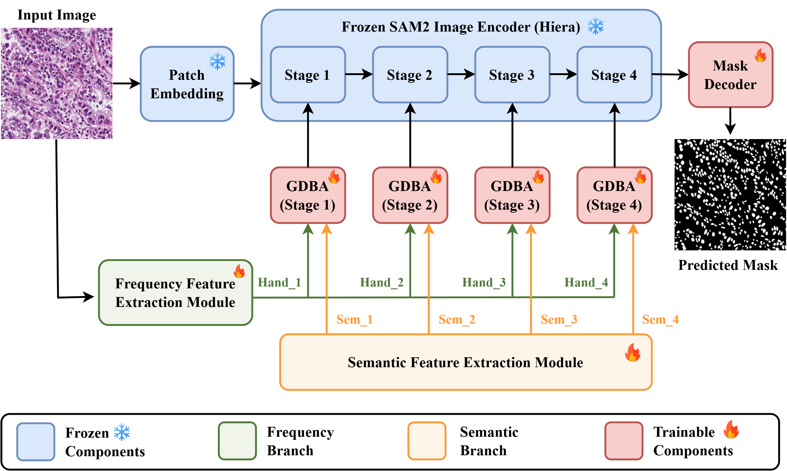
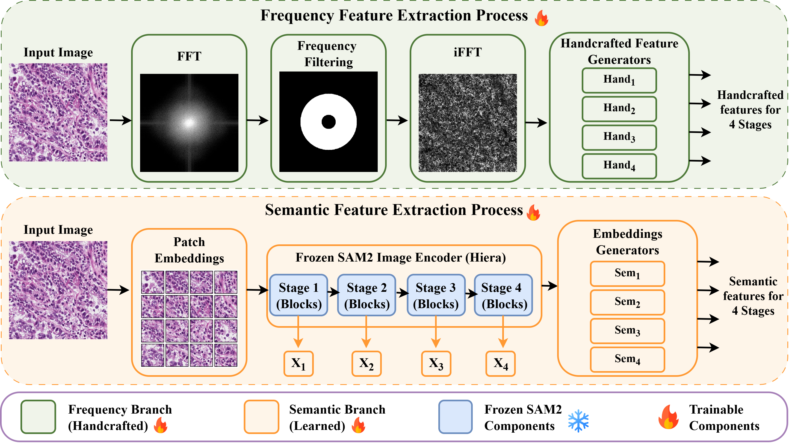
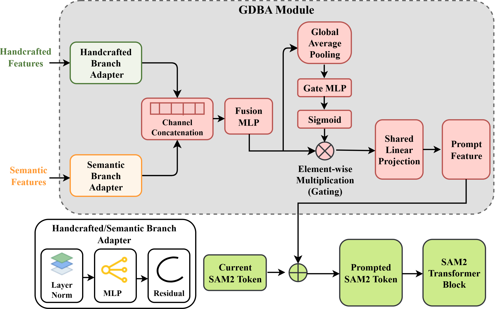

# GDBA-Net: A Gated Dual-Branch Adaptation of SAM2 for Robust Cross-Domain Nuclei Segmentation


## Overview

Accurate nuclei segmentation is a fundamental step in computational pathology, supporting downstream tasks such as cell counting, morphological analysis, spatial profiling, and computer-assisted diagnosis. However, robust nuclei segmentation remains challenging because of variations in nuclear morphology, weak boundaries, densely clustered nuclei, staining differences, tissue preparation, and acquisition conditions.

**GDBA-Net** is a parameter-efficient segmentation framework built upon the hierarchical image encoder of **SAM2** for robust cross-domain nuclei segmentation.

The proposed **Gated Dual-Branch Adapter (GDBA)** combines:

- pretrained semantic representations from SAM2,
- frequency-derived structural information,
- branch-specific Grid MLP adapters,
- adaptive channel-wise gating, and
- shared prompt projection.

Rather than fully fine-tuning the SAM2 image encoder, GDBA-Net preserves the pretrained backbone and introduces lightweight trainable adaptation modules throughout the hierarchical encoder.

## Architecture

GDBA-Net adapts the hierarchical image encoder of SAM2 for biomedical image segmentation while keeping the pretrained encoder frozen. Instead of fully fine-tuning the foundation model, lightweight **Gated Dual-Branch Adapter (GDBA)** modules are integrated throughout the four stages of the SAM2 Hiera encoder. These modules introduce complementary semantic and structural information into the pretrained feature representations.


<p align="center">
  
</p>

<p align="center">
  <b>Overall architecture of GDBA-Net.</b>
</p>

### Semantic and Frequency Feature Extraction

GDBA-Net constructs two complementary feature representations. The **semantic branch** uses hierarchical representations from the pretrained SAM2 encoder to preserve high-level contextual information. In parallel, the **frequency branch** applies FFT-based high-pass filtering to the input image to emphasize structural information such as boundaries, contours, and fine morphological variations. Features from both pathways are generated at multiple resolutions corresponding to the four stages of the SAM2 encoder.


<p align="center">
  
</p>

<p align="center">
  <b>Semantic and frequency-derived feature extraction in GDBA-Net.</b>
</p>

### Gated Dual-Branch Adapter (GDBA)

The **Gated Dual-Branch Adapter (GDBA)** is the core adaptation module of GDBA-Net. Semantic and frequency-derived features are first processed independently using branch-specific Grid MLP adapters and then combined through feature fusion. A sample-adaptive channel-wise gating mechanism regulates the fused representation, allowing the model to selectively emphasize useful structural and semantic information for each input. The resulting prompt features are projected to the SAM2 embedding space and added to the current SAM2 tokens before the corresponding transformer blocks.


<p align="center">
  
</p>

<p align="center">
  <b>Architecture of the proposed Gated Dual-Branch Adapter (GDBA).</b>
</p>


## Installation

### 1. Clone the repository

```bash
git clone https://github.com/biplabpoudel25/GDBA_Net.git
cd GDBA_Net
```

### 2. Create the Conda environment

The recommended installation uses the provided `environment.yml`:

```bash
conda env create -f environment.yml
```

Activate the environment:

```bash
conda activate gdba-net
```

The reference environment uses:

- Python 3.11
- PyTorch 2.3.0
- torchvision 0.18.0
- CUDA 11.8

Alternatively, dependencies can be installed using:

```bash
pip install -r requirements.txt
```

For GPU execution, make sure the installed PyTorch version is compatible with your CUDA environment.

---

## Pretrained SAM2 Model

GDBA-Net uses the pretrained **SAM2 Hiera-Large** checkpoint.

Download the **SAM2 Hiera-Large** pretrained weights and place the checkpoint in the `pretrained/` folder:

👉 [facebookresearch/sam2](https://github.com/facebookresearch/sam2)


```text
pretrained/
└── sam2_hiera_large.pt
```

---

## Data Preparation
Each input image should have a corresponding binary segmentation mask with the same filename. Supported images should be placed in the `images/` directory and their corresponding masks in the `masks/` directory.

Organize the data as:

```text
data/
├── train/
│   ├── images/
│   └── masks/
├── val/
│   ├── images/
│   └── masks/
└── test/
    ├── images/
    └── masks/
```

Dataset paths for training, validation, and testing are specified in:

```text
configs/gdba_net.yaml
```

---

## Tutorials (Google Colab)

We provide Jupyter notebooks demonstrating how to train, test, and run inference with GDBA-Net using Google Colab. Each tutorial includes environment setup, dependency installation, model configuration, and execution examples.

| Tutorial | Description |
|---|---|
| [Training Tutorial](tutorial/GDBA_Net_Training_tutorial.ipynb) | Train GDBA-Net on a custom dataset using the provided configuration. |
| [Testing Tutorial](tutorial/GDBA_Net_Testing_tutorial.ipynb) | Evaluate trained models on different datasets and obtain quantitative segmentation metrics. |
| [Inference Tutorial](tutorial/GDBA_Net_Inference_tutorial.ipynb) | Generate segmentation masks for new images using a trained checkpoint. |

The notebooks can be executed in Google Colab or a compatible Jupyter environment. Users should update the dataset and checkpoint paths according to their setup.

---
## Training

GDBA-Net can be trained using `train.py`.

### Full training

```bash
python train.py \
    --config configs/gdba_net.yaml \
    --sam_ckpt pretrained/sam2_hiera_large.pt \
    --shot 100
```

### Few-shot training

The training script supports:

```text
--shot 1
--shot 5
--shot 10
--shot 100
```

For example, for 5-shot training:

```bash
python train.py \
    --config configs/gdba_net.yaml \
    --sam_ckpt pretrained/sam2_hiera_large.pt \
    --shot 5
```

Training parameters can be modified in:

```text
configs/gdba_net.yaml
```

### Checkpoints

For the default configuration, checkpoints are saved under:

```text
checkpoints/<shot>_shot/gdba_net/
```

For example:

```text
checkpoints/100_shot/gdba_net/
├── model_epoch_best.pth
├── model_epoch_best_loss.pth
└── model_epoch_last.pth
```

For evaluation, we recommend using:

```text
model_epoch_best.pth
```

which corresponds to the best validation segmentation performance.

---

## Testing

Use `test.py` to evaluate a trained GDBA-Net model when ground-truth masks are available.

```bash
python test.py \
    --config configs/gdba_net.yaml \
    --model checkpoints/100_shot/gdba_net/model_epoch_best.pth
```

By default, the test dataset is loaded from the paths specified under `test_dataset` in:

```text
configs/gdba_net.yaml
```

### Using a different test dataset

The test image and mask directories can be overridden without modifying the YAML configuration:

```bash
python test.py \
    --config configs/gdba_net.yaml \
    --model checkpoints/100_shot/gdba_net/model_epoch_best.pth \
    --test_image_path /path/to/test/images \
    --test_label_path /path/to/test/masks
```

This is useful for cross-dataset evaluation.

---

## Inference on New Images

Use `inference.py` to generate segmentation masks for new images when ground-truth masks are not available.

Place the input images in a directory:

```text
example_images/
├── image_001.png
├── image_002.png
└── image_003.png
```

Run:

```bash
python inference.py \
    --config configs/gdba_net.yaml \
    --model checkpoints/100_shot/gdba_net/model_epoch_best.pth \
    --input ./example_images \
    --output_dir ./predictions
```

The predicted binary masks will be saved to:

```text
predictions/
```
---

## Acknowledgments

GDBA-Net builds upon **Segment Anything Model 2 (SAM2)**. We thank the SAM2 authors for publicly releasing their implementation and pretrained models.

---

## License

This project is licensed under the Apache License 2.0. See the [LICENSE](LICENSE) file for details.
